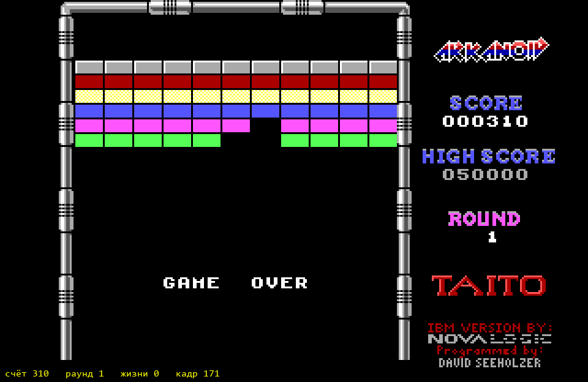

# Neuronoid

Агент, который сам учится играть в оригинальный DOS-Arkanoid (Taito, 1988)
в эмуляторе DOSBox Pure — только по пикселям экрана, как человек.

Дизайн: [docs/superpowers/specs/2026-10-24-neuronoid-design.md](docs/superpowers/specs/2026-10-24-neuronoid-design.md)

## Установка

1. Поставить [uv](https://docs.astral.sh/uv/), затем `uv sync` (создаст окружение на Python 3.12).
2. Скачать ядро эмулятора: `uv run python scripts/fetch_core.py` (появится в `cores/`).
3. Положить свою копию игры в `games/arkanoid/DOS_arkanoid.zip`.
   Папки `games/` и `cores/` не попадают в git.

## Посмотреть, как играет агент

В одном терминале запустить игру (пока — случайный агент):

```
uv run python scripts/play_random.py --steps 5000 --realtime
```

В другом открыть живое окно (его можно открывать и закрывать в любой момент):

```
uv run python scripts/watch.py
```



## Тесты

`uv run pytest`
