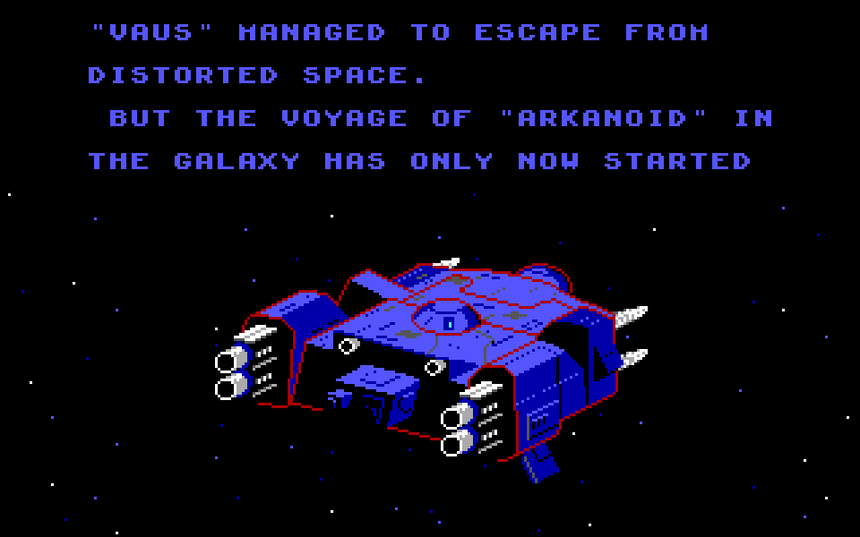
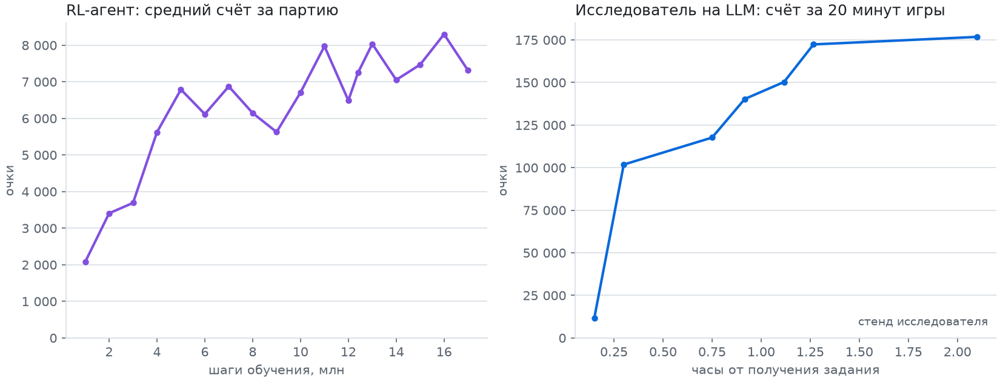
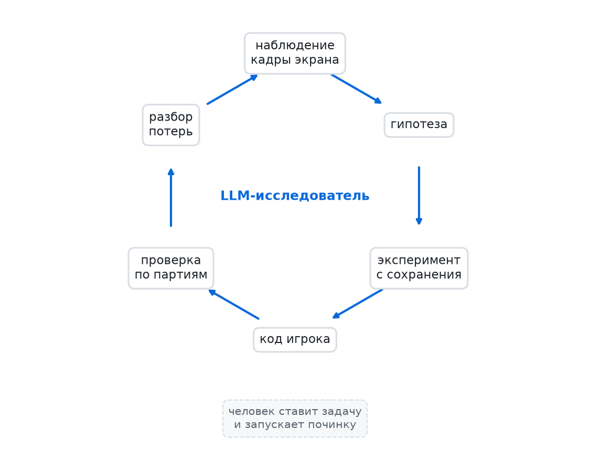
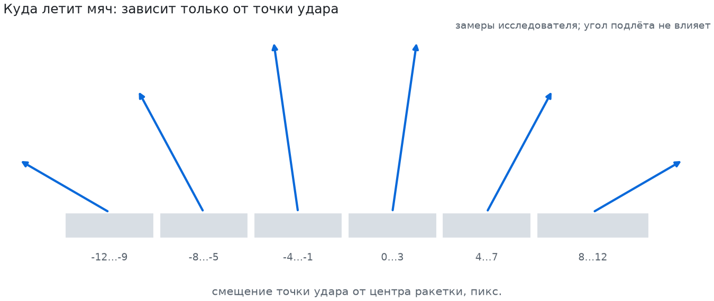

<!--
Варианты заголовка (выбрать автору):
1. Наконец-то я понял Карпаты с помощью Арканоида!
2. Полгода я не понимал Карпаты, пока не взялся за Арканоид
3. Как я наконец понял Карпаты на примере Арканоида
4. Я не программист, и Карпаты мне объяснил Арканоид
-->

# Наконец-то я понял Карпаты с помощью Арканоида!

## Корабль улетает

Это последний кадр DOS-Арканоида 1988 года. Корабль «VAUS» улетает, потому что в 33-м раунде разбит босс DOH.
У игры нет API, в её память никто не лезет. Есть только картинка 320 на 200 пикселей, клавиатура и мышь.

До этого кадра в 10 партиях из 10 дошла программа, которую написал ИИ. Как играть, он разобрался сам, глядя на
экран. «Тело», в котором он работал, и судью, который проверял результат, сделали мы, а задач от меня было три.

Полгода назад, в апреле 2026 года, я посмотрел выступление Андрея Карпаты на конференции Sequoia AI Ascent. Он
рассказывал о трёх поколениях программ. В Software 1.0 человек пишет код. В Software 2.0 собирает данные и
обучает нейросеть. В Software 3.0 «программирование превращается в промпт», а то, что лежит в контекстном окне,
становится «рычагом, которым вы управляете интерпретатором, то есть LLM». Я посмотрел, покивал и, как теперь
понимаю, ничего не понял.

Я не профессиональный программист. Слова про вайб-кодинг, агентов и новую парадигму давно стали для меня
абстракцией: звучат умно, но потрогать их нельзя. Недавно я пересмотрел то выступление и удивился, что теперь
понимаю почти каждое слово. За эти полгода я прошёл ровно тот путь, о котором он говорил. Сначала пытался
научить ИИ играть в Арканоид по старинке, обучением нейросети, и не смог. Потом поставил задачу иначе, и
получилось.

Об этом и статья: как простая игра 1988 года объяснила мне то, что не смогла объяснить лекция.

## Как я делал раньше: Software 2.0

Полгода назад «сделать ИИ, который играет в игру» означало для меня одно: обучение с подкреплением (RL).
Нейросеть смотрит на экран, жмёт кнопки, получает за очки награду и за миллионы попыток учится. Так когда-то
учили сети играть в игры Atari. У меня тогда не вышло.

В этом проекте я прошёл тот же путь ещё раз, аккуратнее, и записывал каждый прогон. Агент видел уменьшенный
экран, двигал ракетку несколькими кнопками и учился около суток на процессоре ноутбука: 17 млн шагов, примерно
17 часов чистого обучения. Средний счёт подрос и застрял на 7–8 тыс. очков. Первый раунд агент по-честному не
прошёл ни разу. Однажды высокий счёт оказался просто сбором капсул: каждая давала тысячу очков, и ловить их
агенту было выгоднее, чем разбивать стену. Я менял награду, давал тренироваться с удобных позиций, увеличивал
число оценочных партий. Каждая правка что-то давала, но потолок стоял на месте.

Весь код для RL написала LLM, Claude, в роли помощника программиста: среду, награды, оценку. Она находила ошибки
и предлагала правки. Но всё это внутри метода, который выбрал я. ИИ в моей голове был обучаемой сетью, а LLM
инструментом, который её строит. Сейчас я понимаю, что это и есть Software 2.0 по Карпаты: программист
«расставляет датасеты и цели обучения». Когда я подкручивал награду и стартовые позиции, я программировал
именно так.

Почему агенту было так трудно, стало понятно позже. Куда улетит мяч, зависит от того, какой точкой ракетки по
нему ударить: ±12 пикселей от центра поворачивают его примерно от 20° до 160°. На уменьшенной вдвое картинке мяч
превращался в размытое пятно, а ракетка двигалась маленькими шагами. Агенту было трудно и заметить этот
механизм, и воспользоваться им. Нашёл его не агент, а я подсказал, и замер мы сделали уже после подсказки.
Зрение и управление мы потом переделали, но новый прогон так и не доучили.

## Как получилось: Software 3.0

Тогда я попробовал по-другому. Отдельная сессия той же LLM получила не задачу «напиши код для обучения», а
«тело» и цель. Тело это эмулятор, программа, которая изображает старый компьютер и включает игру с самого
начала. К нему прилагаются кадр экрана в виде массива пикселей, клавиши, мышь и сохранения: можно запомнить
момент игры и вернуться в него. Цель звучала так: «разберись сам, как играть, и напиши программу-игрока». Я
назвал игру и рассказал, как будет проверяться результат. Как играть, не подсказывал.

Модель была та же, Claude Opus 5.5. Поменялась её роль, а вместе с ней и условия: точное управление мышью,
полный кадр вместо уменьшенного, сохранения для опытов.

И вот что я понял только после видео. Моей программой здесь был уже не код, а текст: задание на одну страницу
и описание тела. Его читала LLM, тот самый интерпретатор, о котором говорил Карпаты. А она уже писала самый
обычный код игрока, которому никакая LLM для игры не нужна. Software 3.0 написало Software 1.0. Моим рычагом
было то, что я положил в контекст: цель, правила и способ проверки.

Начал исследователь так же, как начал бы человек: включил игру и стал смотреть. Нашёл меню выбора видеорежима
и устройства ввода, понял, что клик мышью пропускает вступительную историю, вырезал из кадров шаблоны цифр,
чтобы читать счёт с экрана. Одним из первых опытов выяснил, что мышь двигает ракетку без ограничения скорости:
одним рывком её можно перебросить через всё поле за кадр, то есть за 1/70 секунды. Значит, ракетку можно
поставить куда угодно. Осталось понять, куда целиться.

По истории версий видно, что меньше чем через полчаса после задания вторая версия игрока набрала 101 820 очков
и дошла до раунда 9, не потеряв ни одной жизни. Это замер на собственных прогонах исследователя. Примерно через
2,5 часа наш судья насчитал в среднем 174 тыс. очков и раунды 14–19 за 20 минут игры. Это не соревнование
методов: RL учился около суток на процессоре, а исправленную схему мы так и не обучили. Шкалы несопоставимы,
поэтому на графике две панели. Интереснее не цифры, а то, как исследователь работал.

## Как работал исследователь

**История первая: угол отскока.** Чтобы целиться, исследователь проверил, от чего зависит отскок. Взял из
сохранения один и тот же момент, когда мяч падает вниз. Ставил ракетку с разным смещением относительно мяча и
мерил, как мяч отлетает. Получилось шесть зон в пределах ±12 пикселей: от пологого отскока влево до пологого
вправо. Повторил опыт на другом моменте, вышло то же самое. Значит, угол вылета не зависит от того, как мяч
прилетел. После этого игрок на каждом подлёте просчитывал полёт мяча для каждой зоны и выбирал ту, что быстрее
разобьёт кирпич.

Дальше пошёл обычный круг. Игрок потерял мяч на пологом ударе. Исследователь стал записывать последние кадры
перед каждой потерей и увидел, что ракетка дрожит на пару пикселей и мяч проскакивает мимо края. Попробовал
целиться ближе к центру, и стало хуже: 30 350 очков вместо 95 130. Тогда он вывел правило, до которого я бы сам
не додумался. Промах внутрь безопасен, он меняет только угол. Промах наружу смертелен. Крайние зоны он убрал
совсем, и потери почти исчезли.

В журнале записаны и неудачи: «не ловить замедляющую капсулу: хуже», «выбор точки подачи: в пределах шума»,
«поиск на два отскока: не лучше». Журнал читается как лабораторная тетрадь, а не как отчёт об успехах.

В RL-ветке про отскок я подсказал сам. Здесь подсказки не было. Что модель знала об Арканоиде из своего
обучения, мы проверить не можем. Но опыт она поставила сама и зоны измерила сама, причём в первый же час работы.

**История вторая: починка.** Без лимита времени игрок доходил до последнего, 33-го раунда, и там проигрывал
примерно за 36 секунд. В этом раунде нет кирпичей. Есть босс DOH, каменная голова, которая стреляет. Раньше в
ракетку никто не стрелял, исследователь такого не видел, и игрок не умел уворачиваться. Заметил это не игрок, а
мои длинные прогоны.

Я поставил новую задачу: «дойди до раунда 33 и победи DOH», без подсказок, как. Исследователь разобрал кадры
проигрыша, нашёл снаряды и научил игрока заранее считать, где они пересекут линию ракетки, чтобы там не стоять.
Попутно нашёл две ошибки, которых в обычных раундах не было видно: игрок гонялся за мячом, который уже лежал на
ракетке, а сама ракетка в этом раунде слушалась на кадр быстрее.

Потом судья нашёл новую беду: в одной партии мяч зациклился в раунде 25, и раунд никак не кончался.
Исследователь поправил правило, по которому игрок замечает, что мяч ходит по кругу. Официальный зачёт поймал
застревание ещё раз, в другой партии. Вторая починка была глубже: исследователь 24 раза переиграл раунд 25 с
одного момента, каждый раз чуть сдвигая старт, и нашёл 4 случая, где мяч застревает. Добавил запасной ход:
если застой тянется долго, игрок нарочно пропускает мяч и подаёт заново из выгодной точки.

Каждую починку запускал я, отдельной задачей. Сама себя эта система не лечит. Но довести её можно быстро,
просто поставив задачу словами.

Карпаты на сцене процитировал чужую фразу: «Думать можно поручить, понимать нельзя». Думал здесь исследователь:
ставил опыты и писал код. Понимать оставалось мне: что игрок не видел босса, что зачёт должен вести отдельный
судья, что пора ставить новую задачу на починку. А сам игрок остался обычным кодом: быстрым, предсказуемым, его
можно прочитать и проверить тестами.

## Как проверяли

Здесь до меня дошла ещё одна мысль Карпаты. Обычные компьютеры легко автоматизируют то, что можно описать
кодом, а LLM то, что можно проверить. В нашей песочнице проверялось всё: есть сохранения, эмулятор ведёт себя
одинаково, счёт видно на экране. Без этого исследователю было бы не на чем ставить опыты.

Но верить замерам самого исследователя я не хотел, поэтому оценку давал независимый судья, отдельная программа
в основном репозитории. Он включает игру с самого начала, ждёт случайное число кадров, чтобы партии
различались, передаёт управление игроку и читает всё с экрана: счёт, раунд и финальную заставку с кораблём.
Судью тоже пришлось дважды чинить.

Финальный зачёт: 10 партий с разными задержками старта, лимит 90 минут игрового времени. Итог: 10 побед над DOH
из 10, средний счёт 343 977, от 324 до 370 тыс. Одна партия длится 36–48 минут игрового времени. Предыдущая
версия выиграла 9 из 10. Правда, у двух пар партий случайно совпала задержка старта, и они повторились кадр в
кадр, так что честно это 7 побед из 8 разных партий. Именно тот зачёт и поймал второе застревание в раунде 25.

Сколько это стоило? Я работал по подписке, отдельного счёта нет. Если пересчитать журналы сессий по ценам API
(там платят за объём текста, который модель прочитала и написала), работа исследователя обошлась бы примерно в
$31: игрок с нуля около $12, победа над DOH около $9, две починки около $10. Весь проект вместе с RL, эмулятором,
судьёй и обсуждениями вышел бы около $136.

## Если вы руководитель

Представление «ИИ-проект значит собрать данные и обучить модель» неполное. В нашей системе две части. Первая это
LLM-исследователь. Он ставит опыты, вроде замера отскока или 24 переигровок раунда 25, и по ним пишет решение.
Вторая это исполнитель, обычный код, который работает быстро, ведёт себя одинаково и проверяется тестами.
Обученная модель может быть одним из исполнителей, но не обязана.

**Перепроверяйте старые «нет».** Полгода назад я решил, что такая задача требует долгого обучения с
подкреплением. Сейчас та же LLM, которая писала мне код для RL, в роли исследователя справилась за несколько
часов работы. Вывод «ИИ этого не умеет» стоит пересматривать каждые полгода.

**Программы без API.** Во многих компаниях есть старые системы, у которых нет ничего, кроме экрана. Мы
проверили подход на игре, поэтому для бизнеса это пока гипотеза. К тому же у игры были условия, которых у
учётной системы обычно нет. Можно откатиться к сохранению после любого опыта. Одинаковые действия всегда дают
одинаковый результат. Эмулятор идёт около 2000 кадров в секунду, в десятки раз быстрее реального времени. Кто
захочет перенести подход, сначала должен построить такую песочницу, то есть сделать задачу проверяемой.

**Меняется и роль человека.** Вместо подбора настроек обучения нужно сформулировать задачу, сделать «тело» и
решить, как проверять результат. Без честного судьи «10 из 10» было бы просто словами исследователя о самом
себе.

**Вопросы подрядчику.** Когда вам предлагают «ИИ-решение», спросите:

- Кто проверяет результат, кроме того, кто его сделал, и как?
- Что работает в продакшене: модель или код, который можно прочитать и протестировать?
- Что будет при новом виде сбоя: кто его заметит и кто поставит задачу на починку?
- Кто может пересмотреть саму постановку, то есть что система видит и чем управляет, и как быстро?

## Ограничения

- Игра детерминирована: одинаковые действия всегда дают одинаковую партию. Задержка старта у судьи не больше
  60 кадров, поэтому 10 партий это 10 вариантов начала, а не 10 разных миров.
- «Тело» и судью сделали мы. Исследователь не настраивал эмулятор и не решал, что считать победой.
- RL обучался около суток на процессоре. Это иллюстрация моего прежнего взгляда, а не соревнование методов.
- Каждую починку запускал человек.
- Не искать в интернете и не читать файлы вне своей папки исследователю запрещало задание, технически это не
  было закрыто. А в основном репозитории механизм отскока к тому моменту уже был описан. По журналу сессии
  видно, что исследователь не открывал файлов вне своей папки и не ходил в интернет.
- На стенде исследователя партии судьи не повторяются кадр в кадр при той же задержке старта. Почему, мы пока
  не выяснили.

## Вместо вывода

Полгода назад слова Карпаты про Software 3.0 прошли мимо меня. Я их слышал, но ИИ для меня оставался обученной
моделью, а LLM удобным помощником, который пишет для неё код. Понял я их не из лекции, а из Арканоида: когда
увидел, как мяч летит туда, куда целился игрок, написанный LLM по одной странице текста.

Теперь ИИ-системой я называю связку из трёх частей. LLM, которая разбирается в задаче и строит решение по тексту
задания. Быстрый исполнитель, которого можно проверить. И независимая проверка. Модели за полгода стали сильнее,
и честно сравнить «тогда» и «сейчас» я не могу. Но внутри этого проекта модель была одна, а результат разный.
Поменялось то, что я положил в контекст: не просьбу написать код для обучения, а задачу, тело и судью.

Если вам, как и мне, слова про новую парадигму кажутся слишком абстрактными, найдите свой Арканоид: простую
задачу, где результат видно глазами. Она объяснит лучше лекции.

Код, журнал исследователя и разбор его рассуждений: <ссылка>. Выступление Карпаты:
[оригинал](https://youtu.be/96jN2OCOfLs) и [русский дубляж](https://youtu.be/yZ3d0hTQfAg).
