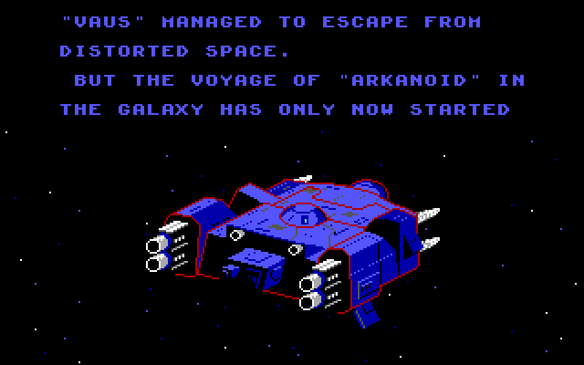
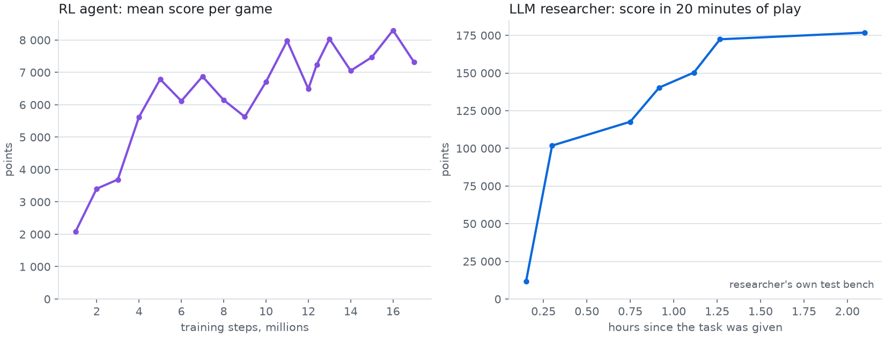
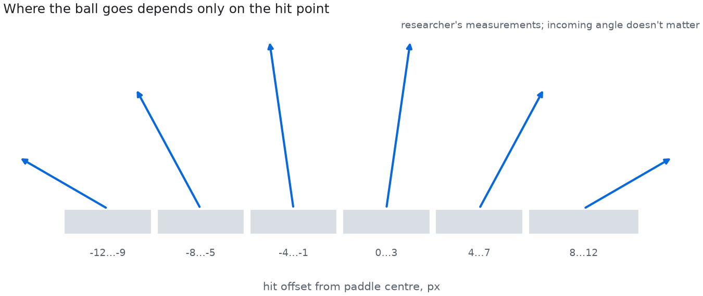

# Why an LLM beat a 1988 game that a day of neural network training couldn't

**An AI agent is only as good as the system around it.** An LLM wrote a program that beat Arkanoid, a 1988 DOS
game, in 10 games out of 10. A neural network I had trained for about a day never cleared the first round. The model
behind both attempts was the same, Claude Opus 5.5. What changed was its role. In the first attempt it was my coding
assistant. In the second it was a researcher inside a system with three parts:

1. a sandbox where it could experiment and fail;
2. an independent referee that checked the result;
3. ordinary code as the output, not an LLM making decisions while the game runs.

The fourth part was me: noticing new kinds of failure and setting the next task. That is the pattern I would now use
for agents in business.

## The starting point

I'm not a professional programmer. Talk about agents and Andrej Karpathy's "Software 3.0" sounded smart to me, but
abstract.

So I first took the classic route to "AI that plays a game": reinforcement learning. A neural network watches the
screen, presses buttons and learns from rewards. Claude wrote all the training code. The agent trained for 17 million
steps on a laptop CPU. Its average score stalled at 7–8 thousand points, and it never cleared all the bricks in
round one.

Then, in a separate session, I gave the same model a different job: here is the game in an emulator, with the screen,
keyboard, mouse and save states; figure out how to play and write a player program. Nothing about how to play.

In under half an hour, its second version scored 101,820 points in its own tests. After about 2.5 hours, the player
averaged 174 thousand points in our referee's 20-minute tests, reaching rounds 14–19.

## 1. A sandbox turns guessing into experiments

The researcher could jump back to any saved moment, and it used that like a lab.

To work out where to aim, it loaded the same falling-ball moment, placed the paddle at different offsets and measured
how the ball flew off. It found six bounce zones within ±12 pixels of the paddle's centre, then repeated the test from
another moment to confirm them. Nobody told it that the bounce depends on where the ball hits the paddle. In the
neural network attempt, I had to point that out myself.

It also learned from its losses. Recording the frames before each lost ball, it saw the paddle jitter by a couple of
pixels, letting the ball slip past the edge. Aiming closer to the centre made things worse: 30,350 points instead of
95,130. So it derived a rule: an error toward the centre only changes the angle, an error toward the edge loses the
ball. It dropped the edge zones, and lost balls almost disappeared.

**In business:** before an agent touches a live system, give it a copy where mistakes are free: a CRM copy with no
access to real payments, a test database, a simulator.

## 2. An independent referee makes "10 out of 10" mean something

I didn't want to rely on the researcher's own numbers. A separate program, the referee, boots the game from scratch,
waits a random number of frames so games differ, hands control to the player and reads the score, the round and
the victory screen straight from the display.

In an official run it caught the ball looping endlessly in round 25, which the
researcher's own tests had missed. The final run: ten games with a 90-minute limit each, 10 wins over the final boss,
mean score 343,977.

Karpathy puts it this way: LLMs "can easily automate what you can verify". The game made checking cheap.

**In business:** the referee could be a test that reconciles the final balance in your accounting system. If you
can't say how you'll know the agent succeeded, it's too early to automate.

## 3. The LLM writes the program; the program does the work

The finished player contains no LLM. It is ordinary code: fast, predictable, readable and testable. The LLM's job was
to figure the game out and write that code.

My own "program" was a one-page assignment: the goal, the rules and how results would be checked. The LLM read it and
wrote plain code. This is what finally made Karpathy's talk click for me: Software 3.0 wrote Software 1.0.

**In business:** don't stop at giving staff a chatbot. Build the LLM into the process where something new has to be
figured out, and keep ordinary code and checks around it.

## 4. A human still owns understanding

The player reached the last round, 33, and lost there in about 36 seconds. The final boss, DOH, shoots at the paddle,
and the researcher had never seen anything shoot. I noticed this in long test games and set a new task, "beat DOH",
without saying how. The researcher studied the frames, found the projectiles and taught the player to dodge them.

The round 25 loop took two fixes. The second time, the researcher replayed the round 24 times from two saved moments,
found 4 cases where the ball got trapped and added an escape move.

Karpathy quoted a line from someone else: "you can outsource your thinking, but you can't outsource your
understanding." The researcher did the thinking. Understanding what was missing, and when to set the next task,
stayed with me.

**In business:** decide upfront who notices a new kind of failure and who sets the task to fix it.

## What it cost

I worked on a subscription, so there is no bill. Recalculated at API prices from the session logs, the researcher's
work would have cost about $31, and the whole project, including the neural network attempt, about $136.

## Questions I would now ask a vendor

- How do you check the result independently of whoever built the solution?
- Where does the model work, and what is handled by ordinary code you can read and test?
- When a new kind of failure appears, who notices it and who sets the task to fix it?

## Caveats

This is not a fair contest between methods. Besides the model's role, the conditions changed: precise mouse control,
the full frame, save states. We never finished training a reworked neural network setup. The game is deterministic,
so the ten games differ only in how they start. We built the game tools and the referee, and a human started every
fix. Web search and files outside its folder were off-limits by the task's rules, not technically; the session log
shows the researcher never went there. We can't tell what the model already knew about Arkanoid from its training.

## Find your own Arkanoid

If agent talk feels abstract, pick a small task where you can see the result with your own eyes, and build the three
parts around the model: a sandbox, a referee and code as the output.

Where in your work could an LLM write the rules, instead of you training a model to learn them?

Code: [neuronoid](https://github.com/askarzh/neuronoid) and
[neuronoid-strategist](https://github.com/askarzh/neuronoid-strategist); the researcher's log is
[LOG.md](https://github.com/askarzh/neuronoid-strategist/blob/main/LOG.md) (in Russian).
