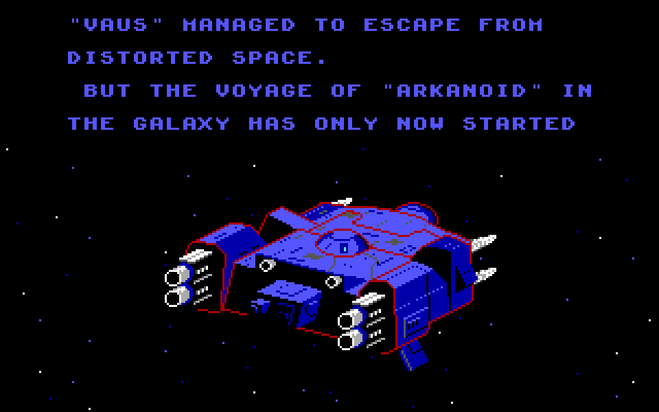
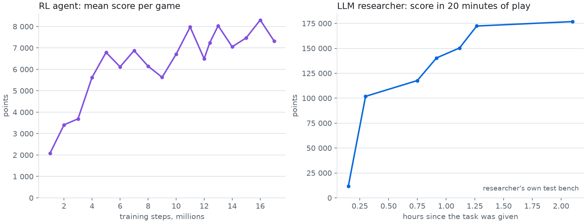
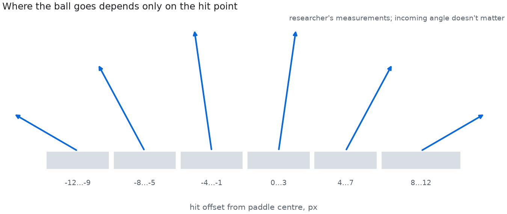

# I nodded along about AI for months. Then I built something I could watch

For months I could follow conversations about AI without being sure I understood them. Agents, vibe coding,
Software 3.0: a new term every few weeks. I used the words. I could follow a demo. But I couldn't tell which
decisions the model was making and which had been made by the people who built the demo.

In April I watched [Andrej Karpathy's talk](https://youtu.be/96jN2OCOfLs) at Sequoia AI Ascent. I followed it,
but I still couldn't connect it to anything I had done myself. I felt awkward admitting that, so mostly I didn't.

What helped was the very first question he was asked on that stage. A few months earlier he had said he had never
felt more behind as a programmer. Asked whether that was exhilarating or unsettling, he said it was "a mixture of
both". He was talking about the changing work of programming, which I don't do. But hearing an expert say that
keeping up felt hard made my own uncertainty less embarrassing.

## Why reading more didn't help

I tried the usual route: more articles, more talks. I was learning new terms faster than I was building any
understanding of them. The explanations stayed abstract. And the question I kept wanting to ask, "but what did it
actually do?", I often didn't ask.

## A small experiment on my own

So I tried something on my own time, with my own subscription, using an old game: Arkanoid, from 1988. A ball, a
paddle, bricks, and a screen that shows you everything. I'm not a professional programmer. Agents helped me build
the tools I couldn't have written myself: the access to the game, the training pipeline, a separate program to
check results. I described what I wanted in plain language.

Then I tried to make an AI play the game, in the two ways I knew of.

**First, the way I thought AI worked.** Train a neural network using rewards. Claude, a large language model (LLM),
wrote all the training code for me. The network trained for about a day, 17 million steps. Its average score
stalled at 7–8 thousand points, and it never cleared all the bricks in round one. I changed the rewards, but
couldn't get past the plateau.

**Then, the thing everyone kept calling an agent.** I gave a separate session of the same model a goal instead of a
method: here is the game, you can see the screen, press keys, move the mouse, save and reload moments; figure out
how to play and write a player. Nothing about how to play.

In under half an hour, in its own tests, its second version scored 101,820 points. After about 2.5 hours it had
written a player that averaged 174 thousand points in the referee's 20-minute tests, reaching rounds 14–19.

## The first thing I could point to

To aim, the agent needed to know how the ball bounces off the paddle. I hadn't given it that rule, and I hadn't told
it what experiment to run. It chose one itself: it loaded the same falling-ball moment from a save state, placed the
paddle at different offsets, measured where the ball went, and found six zones within ±12 pixels. Then it checked
them again from another moment.

For the first time I could point to a decision the agent had made. It had decided what it didn't know, found a way
to measure it, and used the answer. The ball and the paddle gave me something concrete to attach the words to.

## The second thing

Without a time limit, the player reached the last round, 33, where the boss turned out to shoot at the paddle. The
agent had never seen anything shoot, and the player lost all its lives in about 36 seconds. I noticed it on long
runs and set a new task, "beat it", without saying how. The agent found the projectiles in the frames and taught
the player to dodge.

Then the referee, a separate program that checks each game from the screen, found a game where the ball kept
looping in round 25 until the test timed out. Activity, no progress. The agent's own tests had looked fine. And the
referee itself had to be fixed twice before it could tell a win from a loss. I had read that results need checking.
I hadn't expected to spend time fixing the checker too.

In the end the player won 10 test games out of 10. The finished player runs without an LLM or a trained network: it
is ordinary code the agent wrote.

## What stayed with me

Not a tool; tools will change again. What stayed is the sequence: an experiment the agent chose, a result, a failure its own tests missed, a
check that needed checking. Now when I hear "agentic workflow", I have one concrete case of what it looks like when
it works, and what it looks like when it quietly doesn't.

At API-equivalent rates, the research agent's model usage would have been about $31, and the whole project,
including the failed training attempt, about $136. I used a subscription, and that doesn't count my time.

The honest limits: this was not a fair contest between methods. The agent also had precise mouse control, the full
frame and save states, and I never finished training the revised network. The game is deterministic. Claude and I
built the game tools and the referee, and I started every fix. I can't tell what the model already knew about
Arkanoid from its training.

## If you've nodded too

This is what helped me. Pick a small problem you can watch: a game, a toy version of something you know. Ask an
agent to figure it out. Then watch what it tries, what makes it change course, and what your check catches that it
missed. It gave me something to reason about that months of reading hadn't.

Code: [neuronoid](https://github.com/askarzh/neuronoid) and
[neuronoid-strategist](https://github.com/askarzh/neuronoid-strategist); the agent's log is
[LOG.md](https://github.com/askarzh/neuronoid-strategist/blob/main/LOG.md) (in Russian).
