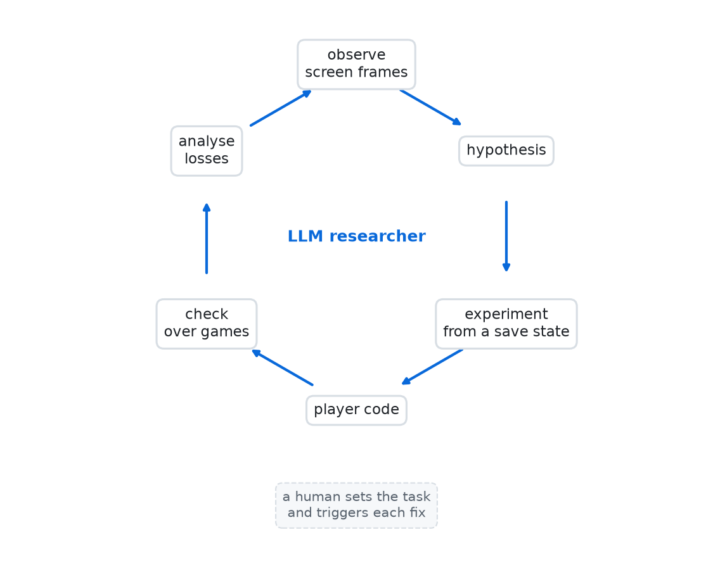

# Six months ago I couldn't build an AI that plays Arkanoid. It worked once the LLM stopped being "the assistant"

This is the last screen of Arkanoid for DOS, released in 1988. The ship escapes after the final boss, DOH, is
destroyed in round 33. No API, no memory access — only a 320×200 picture, a keyboard and a mouse.

A program written by AI reached this screen in 10 games out of 10. The AI figured out how to play by looking at
the screen — inside a sandbox we built, on three tasks I gave it — and an independent referee, also ours,
checked the result.

Six months ago I tried the same thing and failed. What changed was not only the models, but my idea of what an
AI system is.

## What I used to think AI was

To me, "build an AI that plays a game" meant reinforcement learning (RL): a neural network looks at the screen,
presses buttons, gets points as a reward and learns over millions of attempts.

In this project I tried again. The agent trained for about a day on a laptop CPU — 17
million steps. Its average score plateaued at 7–8 thousand points. It never honestly cleared the first round; it
only reached round two through a bonus capsule that opens an exit in the wall. Reward tweaks helped a little; the
ceiling held.

All the RL code was written by an LLM — Claude, acting as my programming assistant. It also found bugs and
suggested fixes, but always inside the method I had chosen. In my head, "the AI" was the trained network and the
LLM was a tool for building it.

## The turning point

Then I changed the setup. A separate session of the same LLM got a "body" and a goal instead of a coding task.
The body: an emulator that boots the game from scratch, screen frames as pixel arrays, keys, mouse, and save
states to rewind to any moment. The goal: "figure out how to play and write a player program." It was told the
game's name and how it would be judged — nothing about how to play.

The model was the same in both roles: Claude Opus 5.5. Only the role changed.

In under half an hour, the second version of its player scored 101,820 points and reached round 9 without
losing a life, on the researcher's own test runs. In about 2.5 hours it averaged 174 thousand points and rounds
14–19 under our referee in 20 minutes of play. This is not a contest between methods: RL trained for about a day
on a CPU, and we never finished training its improved version.

## Under the hood: a research loop

One early experiment showed that the mouse moves the paddle with
no speed limit: one sharp move crosses the whole field in a single frame. So the paddle can be anywhere instantly
— the question is where to aim.

To aim, it tested what decides the bounce. It loaded the same falling-ball moment from a save state, placed the
paddle at different offsets and measured the ball's velocity afterwards. Result: six discrete zones within ±12
pixels, from a shallow bounce left to a shallow bounce right, regardless of the incoming angle. The player then
simulated each zone on every approach and picked the one that broke a brick fastest.

When the player lost balls on shallow shots, it recorded the frames before each loss and concluded: an aiming
error towards the centre only changes the angle, one towards the edge is fatal. It dropped the edge zones and
losses nearly vanished. The log records failed ideas too.

In the RL track, the same bounce mechanism appeared only after I hinted at it. Here nobody hinted. We can't
control what the model knew about Arkanoid from training; its contribution was to run the experiment and measure.

In round 33 the boss shoots, nothing earlier does, and the player lost all lives in
about 36 seconds. I set a new task — "reach round 33 and beat DOH" — without saying how. The researcher found the
projectiles in the frames and taught the player to dodge. Later the referee caught the ball looping
forever in round 25; the researcher replayed that round 24 times from one moment, found 4 trapped cases and added
an escape move. Every fix was a separate task that I started. This is not a "self-healing" system; it is a system
you can improve quickly by stating the problem in words.

## How it was verified

The referee boots the game, waits a random number of frames, hands control to the player and reads score, round
and the ending from the screen. Final run: 10 games, a
90-minute limit, 10 wins over DOH, mean score 343,977. The previous version won 9 of 10 (7 of 8 distinct games — two
pairs repeated frame for frame); that run caught the round-25 loop a second time.

At API prices, the researcher's work would have cost about $31; the whole project, including RL, the emulator and
the referee, about $136. I used a subscription, so this is an estimate, not a bill.

## What this means if you run technology

**Re-test old "no"s.** Six months ago I concluded this needed long RL training. The same LLM that wrote my RL code
did it in a few hours of work once it had a different role.

**Software without an API is a candidate — with conditions.** Many companies run legacy systems that only have a
screen. We showed this on a game, so for business it is a hypothesis. The game also gave us things a production
system rarely does: rewindable save states, identical results for identical actions, and an emulator running far
faster than real time. Build that sandbox first.

**Questions to ask a vendor:**

- Who verifies the result, independently of whoever built it?
- What runs in production — a model, or code you can read and test?
- When a new kind of failure appears, who notices it and who sets the task to fix it?
- Who can change the setup itself — what the system sees and controls — and how fast?

## Limitations

The game is deterministic, and the referee's random start delay is at most 60 frames, so 10 games are 10
different openings, not 10 different worlds. We built the body and the referee. RL trained only briefly. A human
started every fix. Bans on web search and on reading files outside its folder were rules in the task, not
technical barriers — and our main repo already described the bounce mechanism by then. The researcher's session
log shows it never read files outside its folder or went online.

Six months ago I thought AI was a trained model and an LLM was a helpful assistant writing code for it. Now I call
an AI system the combination: an LLM that understands the task and builds the solution, a fast verifiable
executor, and an independent check. Models also got stronger in six months, so I can't compare then and now
fairly. But within this project the model was the same and the outcome was different — the role mattered a lot.

Code and the research log: <link>.
