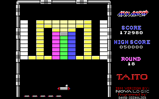
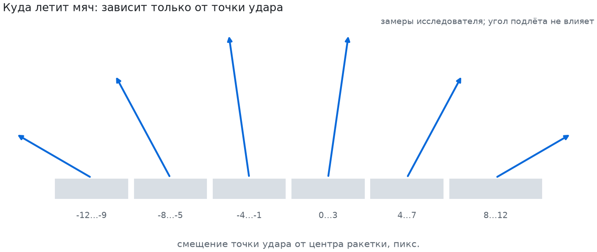

# Как большая модель сама разобралась в DOS-Арканоиде

*Neuronoid · эксперимент «стратег». Страница составлена Claude по журналу исследователя
[`LOG.md`](https://github.com/askarzh/neuronoid-strategist/blob/main/LOG.md) и коммитам репозитория
[neuronoid-strategist](https://github.com/askarzh/neuronoid-strategist).*

Отдельной сессии Claude дали только «тело»: эмулятор с игрой с момента включения, экран, клавиатуру, мышь и
сохранения, и задание «разберись и играй как можно лучше». Без описаний игры и без наших знаний; заглядывать в
основной проект запрещало задание. Ниже показано, как она рассуждала, по её журналу и коммитам.

| | RL-агент · нейросеть по пикселям (PPO) | Исследователь · рассуждение + код |
|---|---|---|
| Обучение / работа | около суток, 17 млн шагов | ~2,5 часа |
| Средний счёт | 7 312 | 174 156 (10 игр) |
| Раунды | первый раунд ни разу не очищен от кирпичей (во второй выходил только через капсулу «B») | 14–19 к 20-й минуте |
| Жизни | обычно теряет все 3 | Game Over ни в одной из 10 игр |

*Игрок исследователя, раунд 18, 172 980 очков, пять запасных жизней. Кадр из партии с включения питания.*

Счёт и раунды исследователя дала оценка нашим судьёй: 10 игр с включения питания, по 20 минут игрового времени,
итог читается с экрана теми же датчиками, что оценивали RL-агента.

Условия у двух подходов были разные: исследователь видел полный кадр, управлял мышью без ограничения скорости и
пользовался сохранениями, а доработанный RL-прогон мы так и не доучили. Это история двух подходов в одном
проекте, а не равное соревнование RL и LLM.

## Ход результата за два с половиной часа

| Время коммита | Версия | Счёт за 20 минут | Раунд |
|---|---|---:|---|
| 12:07 | v0 | 28 950 | 3 |
| 12:16 | v1 | 101 820 | 9 |
| 12:43 | v2, прицеливание по зонам | 117 670 | 13 |
| 12:53 | ловля капсул | 140 340 | — |
| ~13:05 | лазер | 150 320 | 14 |
| 13:14 | прицеливание по темпу разрушения | 172 390 | 15 |
| 14:04 | несколько мячей | 176 805 (среднее по 4 партиям) | — |

Время в таблице и в заголовках ниже — момент коммита версии; сами замеры могли быть сделаны чуть позже. Счёт —
одна и та же партия с включения (вариант старта «сид 0», см. ~13:30) на стенде исследователя за 20 минут игрового времени; последняя строка —
среднее по 4 партиям. Для сравнения: лучшая оценка RL-агента за всё обучение — 8 301 (на 16 млн шагов).

## Как он думал: наблюдение → гипотеза → эксперимент → вывод

Главный приём — сохранения: из одного и того же момента игры он пробует разные действия и сравнивает исходы.
Каждая находка ниже записана им самим в журнал `LOG.md`.

### 11:58 · Включение и меню

- **Увидел.** Текстовое синее окно «Please select a video mode»: CGA, EGA, Tandy. Потом «input device»: Mouse,
  Joystick, Keyboard.
- **Проверил.** Нажатие длиной в один кадр засчитывается, значит, игроку не нужно удерживать клавиши между вызовами.
- **Нашёл сам.** Второй клик во время вступительной истории пропускает её и сразу ведёт в раунд 1.
- *Ошибка по дороге:* детектор меню смотрел в белый текст.

### 12:07 · Устройство мира и первый игрок (v0) — 28 950, раунд 3

- **Измерил.** Поле, кирпичи 15×7 с шагом 16×8, рисунок мяча 5×5, ракетку в 25 пикселей; мяч сам стартует через
  ~125 кадров.
- **Эксперимент.** Мышь: сдвиг `dx` двигает ракетку на `dx/4` пикселя, задержка ровно 3 кадра, **скорости нет
  предела**.
- **Вывод.** «Защита может быть почти идеальной; вопрос в прицеливании». Игрок предсказывает точку падения с
  отражениями от стен.

### 12:16 · Разбор потерь покадрово (v1) — 101 820, раунд 9, без потерь

- **Почему проиграл.** Сверка «экран против команды» раскачивала ракетку на 100+ пикселей; верх врага-«молекулы»
  совпал с неполным шаблоном мяча.
- **Исправил.** Позиция = видимая + сдвиги последних 3 команд; полный шаблон мяча; трек нескольких мячей.

### 12:43 · Открыл механизм отскока сам (v2) — 117 670, раунд 13

- **Эксперимент.** Из одного момента ставит ракетку с разными смещениями «мяч − центр ракетки» и меряет скорость
  после удара; на двух разных моментах результат одинаковый.
- **Вывод.** Шесть ступеней по 4 пикселя; **угол вылета не зависит от угла подлёта**; за пределами ±12 — промах.
  Отсюда правило: «ошибка внутрь безопасна, наружу — смертельна».
- **Ещё.** Золотые кирпичи неразрушимы: ни один не исчез за 6 минут в раунде 3. Против застревания в «лабиринте»
  из золота — поиск на два отскока вперёд.
- *Неудача:* целиться ближе к центру — 30 350, откат.

| Смещение, пикс. | −12…−9 | −8…−5 | −4…−1 | 0…3 | 4…7 | 8…12 |
|---|---|---|---|---|---|---|
| Вылет | пологий влево | 45° влево | крутой влево | крутой вправо | 45° вправо | пологий вправо |

### 12:53 · Капсулы: ветвление «поймать или нет» — 140 340; с лазером 150 320, раунд 14

- **Эксперимент.** Из одного момента: поймать капсулу или пропустить, и сравнить, что изменилось.
- **Нашёл.** Каждая капсула +1000 очков; зелёная — мяч прилипает; бирюзовая — три мяча; голубая — ракетка
  25 → 37; красная — лазер из точек центр ± 8; коричневая — мяч медленнее.

### 13:14 · Сменил критерий цели — 172 390, раунд 15

- **Заметил.** «Быстрее до первого кирпича» держит мяч под стеной: в раунде 1 — кирпич на 160 кадров.
- **Новый критерий.** Симуляция полёта до возвращения к ракетке: «разбито за полёт ÷ время полёта» — загоняет
  мяч за стену.
- *Неудача:* пологие углы при медленном мяче — хуже, откат.

### ~13:30 · Честная оценка — сам

- **Понял.** Партия детерминирована, но хаотична: любое изменение игрока даёт другую партию. Разброс между
  партиями — ±15–20 тысяч.
- **Сделал.** «Сиды» (задержка первого действия) и оценку по 4–5 партиям; изменения в пределах разброса не
  принимает.
- **Точность.** Свою симуляцию проверил: угадывает первый кирпич в 44% отскоков. Причина — пологий мяч касается
  ракетки на кадр позже; поправка дала 58% → 70% точных ударов.

### 14:04 · Несколько мячей — среднее 176 805 по 4 партиям, 0 потерь

- **Исправил.** После мультимяча вёл один трек и терял остальные. Теперь трек у каждого мяча, следит за тем,
  что раньше долетит.
- *Неудача:* не ловить зелёные и коричневые капсулы — хуже.

## Кто что выяснил

| Факт об игре | RL-проект (мы с автором) | Исследователь |
|---|---|---|
| Мышь позволяет мгновенно переставлять ракетку | Начали с перебора клавиш в первые часы проекта | Прочитал меню, выбрал мышь и измерил её преимущества |
| Скорость ракетки не ограничена | Не заметили: RL-агенту дали смещение не больше ±14 | Эксперимент с `dx=400` в первые 10 минут |
| Угол отскока зависит от точки удара | Подсказка автора через 17 млн шагов, затем замер | Сам, замером из сохранения, через 45 минут |
| Угол не зависит от угла подлёта | Не заметили | Тот же эксперимент на двух моментах |
| Капсулы и их эффекты | Знали только «B» (выход) и что капсула даёт 1000 очков | Пять эффектов из семи, ветвлением из сохранения |
| Нужна оценка по нескольким партиям | После ложной «просадки» на 10 играх | Сам, заметив хаотичность партий |
| Узкое место — последние кирпичи | ~12 млн шагов и три попытки: учебная программа, новая награда, награда за кирпичи | Замер «кирпич на 160 кадров» и новый критерий цели |

## Что это значит: LLM пишет, обычный код играет

**Почему так быстро**

- Он не учит «видеть мяч» миллионами проб: понятия «мяч», «траектория», «отскок» у него уже есть.
- Сохранения делают каждый вопрос экспериментом: один момент — много вариантов действия.
- Итог — обычная программа на Python: она играет сама, без нейросети и без LLM.

**Что честно оговорить**

- Большая модель знает о мире и, вероятно, об арканоидах вообще: это готовые знания, а не выведенные из пикселей.
- Его датчики — тоже ручные правила (шаблоны цифр и мяча), просто придуманные им по наблюдениям.
- Хвост раунда по-прежнему занимает 25–30% времени; эффект серой и пурпурной капсул не выяснен.

*Эта страница описывает первые ~2,5 часа работы исследователя (до 176 805 очков). Дальнейшие задачи — победа над
боссом DOH и две починки раунда 25 — описаны в [`LOG.md`](https://github.com/askarzh/neuronoid-strategist/blob/main/LOG.md)
и в статье [`habr.md`](habr.md).*
