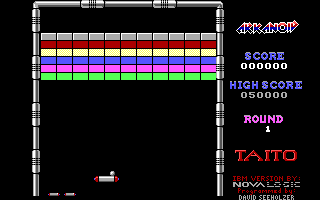
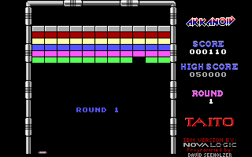

# Отчёт о проверке: DOSBox Pure + Arkanoid из Python

Дата: 2026-10-24. Скрипт: `scripts/spike.py`. Машина: Core Ultra 7 255H, Windows 11.

**Вердикт: идём дальше по подходу B.** Игра работает, savestates есть, детерминизм
полный, если после каждого кадра синхронизироваться с потоком ядра (см. «Детерминизм»).
С синхронизацией скорость около 1300–1700 кадров/с на экземпляр (порог — 300)
и около 14 000 суммарно на 12 процессах.

## 1. Фронтенд

`libretro.py` 0.12 подходит, но есть три оговорки:

- **Perf-драйвер сломан.** С драйвером по умолчанию `retro_init` падает с
  `TypeError: expected CFunctionType instance`. Решение: `Session(..., perf=None)`.
- **Клавиатурные события не передаются.** Ядро регистрирует `retro_keyboard_callback`,
  а `IterableInputDriver` его не вызывает (в коде TODO). Решение: вызывать
  `session.input.keyboard_callback(down, keycode, character, modifiers)` напрямую.
  Так работает вся навигация по меню.
- **Звук копится без ограничений.** `ArrayAudioDriver` накапливает сэмплы в `array`,
  поэтому за миллионы кадров переполнится память. Эмулятор должен очищать буфер
  на каждом шаге.
- Скриншот из `ArrayVideoDriver.screenshot()` собирается попиксельно на Python
  и работает медленно. Кадр берём сами через `numpy` из буфера драйвера: формат
  XRGB8888, в памяти BGRX, у строки есть `pitch`.

Свой ctypes-фронтенд **не нужен**.

## 2. Запуск игры

Zip отдаётся ядру как контент. DOSBox Pure сам находит `ARKANOID.COM` и запускает его
без своего меню. Защиты от копирования нет: загрузчик `ARKANOID.COM` (130 байт) просто
грузит `ARKANOID.DAT`.

## 3. Опции ядра и экран

- `dosbox_pure_cycles = "4720"` (класс 286). Остальные опции по умолчанию.
- Видеорежим: EGA. Кадр в игре **320×200**, меню текстовые 640×400. `fps` ядра — **70,087**.
- **Скорость игры не зависит от циклов CPU.** Мяч после запуска движется одинаково
  при 1320, 2750, 4720 и 13 400 циклах (2,5 пикселя/кадр). Игра идёт по таймеру.
  Меняется только время загрузки. `max` даёт 22 кадра/с, его брать нельзя.
  `auto` меняет циклы по нагрузке хоста, поэтому для воспроизводимости берём фиксированное значение.

| cycles | кадров/с |
|---|---|
| 1320 | 2759 |
| 2750 | 2766 |
| 4720 | 2318 |
| 13 400 | 1210 |
| auto | 1803 |
| max | 22 |

4720 выбрано с запасом: на поздних раундах с врагами при меньшем CPU игра может
начать тормозить, а 4720 соответствует оригинальному железу. Если понадобится
скорость, можно проверить 2750.

## 4. Управление — **мышь, не клавиатура** (отступление от дизайна)

- В режиме «K: Keyboard» ракетка **не реагирует** на стрелки, цифровую клавиатуру и
  25 проверенных букв и знаков. Изредка видно одно смещение на 3 пикселя, похоже на
  проблему автоповтора в эмуляции клавиатуры.
- В режиме «M: Mouse» ракетка движется плавно и пропорционально смещению мыши.
  За 30 кадров при `dx` = +4/кадр она проходит 25 пикселей, при +10/кадр — 63 пикселя.
  Левая кнопка запускает мяч (и стреляет лазером).
- Мышь подаётся как `MouseState(x=dx, left=...)` через генератор `input` у `Session`.
- **Решение:** агент управляет мышью с **дискретным** набором действий (несколько
  фиксированных `dx` плюс кнопка). Набор действий остаётся маленьким, а управление
  точнее, чем с клавиатуры. Под мышь эта DOS-версия и рассчитана.

## 5. Последовательность до игры (подготовка, не управление агентом)

| Кадров ждать | Действие | Экран |
|---|---|---|
| 150 | Enter (`RETROK_RETURN`, char 13) | выбор видеорежима, по умолчанию EGA |
| 60 | `M` (char `m`) | выбор устройства ввода → мышь |
| 700 | Space (char 32) | титульный экран с рекордами → старт игры |
| ≈1480 | — | вступление (пробел его не пропускает), затем «ROUND 1» и мяч на ракетке |

Нажатие клавиши — `keyboard_callback(True, …)`, 5 кадров, `keyboard_callback(False, …)`.
Кадр «мяч на ракетке» наступает примерно через 1480 кадров после Space. Через
~10 секунд игра запускает мяч сама.

## 6. Экран (кадр 320×200)

 

| Что | Где (y0–y1, x0–x1) |
|---|---|
| Игровое поле (внутри стен) | y 5–189, x 32–223 |
| Ракетка | y 176–181 |
| Счёт игрока (6 цифр, белые на чёрном) | y 63–68, x 241–286 |
| Рекорд (6 цифр) | y 92–97, x 241–286 |
| Номер раунда | y 126–131, около x 266 |
| Иконки запасных жизней | y ≈ 190–195, x ≈ 40–75 (в начале 2 иконки + текущая жизнь = 3) |

- **Потеря жизни:** иконка исчезает, в центре поля снова «ROUND N», мяч опять на ракетке.
- **Game Over:** отдельного экрана «GAME OVER» при выборке раз в 200 кадров не видно.
  Игра уходит на **титульный экран** с рекордами (кадр без поля), затем крутит
  **демо-режим** с игровым полем ([кадр](img/07_attract_demo.png)). Значит, конец
  игры надо ловить по переходу на титульный экран и не принимать демо за игру.
- Меню: [видеорежим](img/01_video_menu.png), [ввод](img/02_input_menu.png),
  [титул](img/03_title.png), [вступление](img/04_intro.png).

## 7. Защита от копирования

Нет.

## 8. Скорость и savestates

- Один экземпляр, `cycles=4720`, без вывода: **≈2500 кадров/с**. С копией кадра
  в `numpy` каждые 4 кадра (как при обучении): **≈2230 кадров/с**.
- Savestate: **≈525 КБ**, сохранение и загрузка через `core.serialize/unserialize`.
- Детерминизм: см. раздел «Детерминизм» ниже. Первоначальный вывод «детерминизм есть»
  был неверен: проверялся только последний кадр.

## 9. Вердикт

Идём дальше. Запасные пути не нужны. Для `LibretroEmulator` (Task 3):
`perf=None`, клавиатура через `keyboard_callback`, мышь через генератор ввода,
очистка звукового буфера, кадр через `numpy`, `dosbox_pure_cycles=4720`.

## Найдено при реализации `LibretroEmulator`

- **Картинка после `unserialize` запаздывает.** Буфер вывода ядра не входит в
  savestate, и первый кадр после загрузки показывает то, что было до неё. Какой
  именно кадр, зависит от предыстории и даже от пауз в реальном времени: у ядра
  свой поток эмуляции. Поэтому `load_state` прогоняет 2 кадра
  (`LOAD_SETTLE_FRAMES`). Подобрано тестом со случайной историей и паузами.
- ~~Сама игра детерминирована и при случайных паузах~~. Это было неверно, см.
  «Детерминизм».
- **Скорость ракетки ограничена игрой**: около 1 пикселя за кадр при `dx=4`,
  около 2,5 пикселя за кадр при `dx=10`. Ракетка догоняет смещение мыши с задержкой
  в несколько кадров. Это стоит учесть при выборе набора `dx` для агента.

## Детерминизм (найдено на финальном ревью)

- **Проблема.** Без синхронизации повтор с одного savestate с одинаковой мышью
  расходится на 4–10% шагов: 12–39 из 300 кадров, если сравнивать кадр после **каждого**
  шага. Без движения мыши расхождений нет. Первые тесты сравнивали только последний кадр
  и этого не видели.
- **Причина** (по исходникам DOSBox Pure, `retro_run`). Ядро читает ввод и ставит
  событие мыши в очередь, затем ждёт конца *предыдущего* кадра (`TCM_FINISH_FRAME`)
  и запускает следующий **асинхронно** (`TCM_NEXT_FRAME`). Поток эмуляции разбирает
  очередь событий по ходу кадра, поэтому в какую миллисекунду эмуляции ляжет движение
  мыши, зависит от того, насколько поток успел продвинуться, то есть от времени хоста.
  Опции «latency» в этой сборке нет, режимы троттлинга не помогают.
- **Решение.** После каждого `retro_run` вызывается `retro_get_system_av_info`
  напрямую через ctypes. В DOSBox Pure эта функция выполняет `TCM_FINISH_FRAME`, то есть
  дожидается конца кадра. Тогда расхождений 0 из 300, и со случайными паузами между
  шагами тоже. Тест: `test_replay_deterministic_every_step`.
- **Цена.** Пропадает конвейер «Python готовит следующий шаг, пока ядро считает кадр»:
  один экземпляр даёт 1300–1700 кадров/с вместо 2400. Зато каждый экземпляр занимает
  одно ядро вместо двух, и суммарная скорость сохраняется (см. ниже).
- `retro_serialize_size` после каждого кадра для синхронизации **не годится**:
  процесс завис на несколько часов.

## Параллельный прогон

`scripts/bench_parallel.py`: каждый процесс проходит до раунда 1 и гоняет случайную мышь
с frame skip 4, забирая кадр каждые 4 кадра; каждые 2000 кадров — `load_state`, как сброс
эпизода. Запуск 1: по 5000 кадров на процесс. Запуск 2: по 8000.

| процессов | суммарно кадров/с (запуск 1) | запуск 2 | на процесс |
|---|---|---|---|
| 1 | 2823 | — | 2823 |
| 4 | 5975 | — | 1500 |
| 6 | — | 10 684 | 1794 |
| 8 | 15 136 | 13 444 / 13 242 | ≈1700–1900 |
| 10 | — | 12 960 | 1322 |
| 12 | 13 727 | — | 1172 |
| 14 | 12 588 | — | 913 |

- **Рекомендация: 8 экземпляров**, около 13–15 тысяч кадров/с суммарно. Это в 5–10 раз
  больше оценки из дизайна (1500–3000). При 10 и больше процессах скорость падает:
  у каждого экземпляра DOSBox Pure свой поток эмуляции, и 8 процессов уже занимают
  все 16 ядер. Самой нейросети при обучении тоже понадобятся ядра, так что
  итоговое число экземпляров подберём на этапе обучения (вероятно, 6–8).
- Замеры шумные: у процессора гибридные P- и E-ядра, и на скорость влияет нагрев.
- 10 млн кадров — это около 12–13 минут чистой эмуляции.

**После включения синхронизации** (запуск 3, по 6000 кадров):

| процессов | суммарно кадров/с | на процесс |
|---|---|---|
| 1 | 1717 | 1717 |
| 8 | 7883 | 992 |
| 12 | 13 927 | 1169 |
| 14 | 10 738 | 783 |
| 16 | 9529 | 633 |

Теперь оптимум около **12 экземпляров**, примерно 14 000 кадров/с суммарно. Это тот же
уровень, что и без синхронизации, только на большем числе процессов. Замеры шумные,
точное число подберём на этапе обучения вместе с нагрузкой от нейросети.
