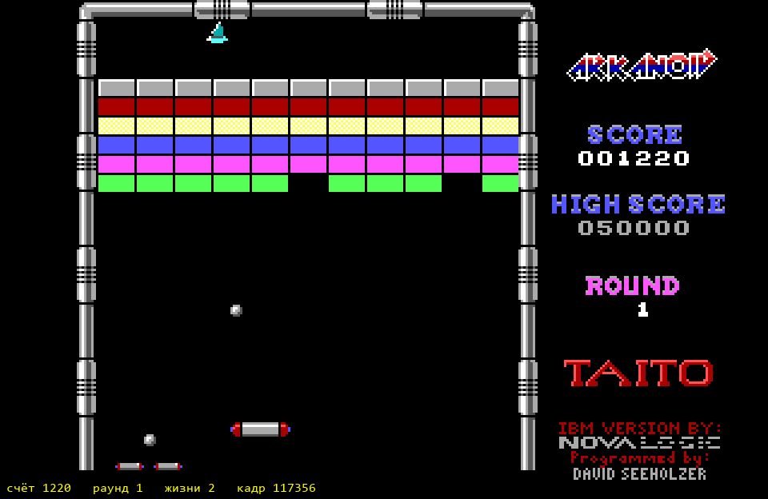
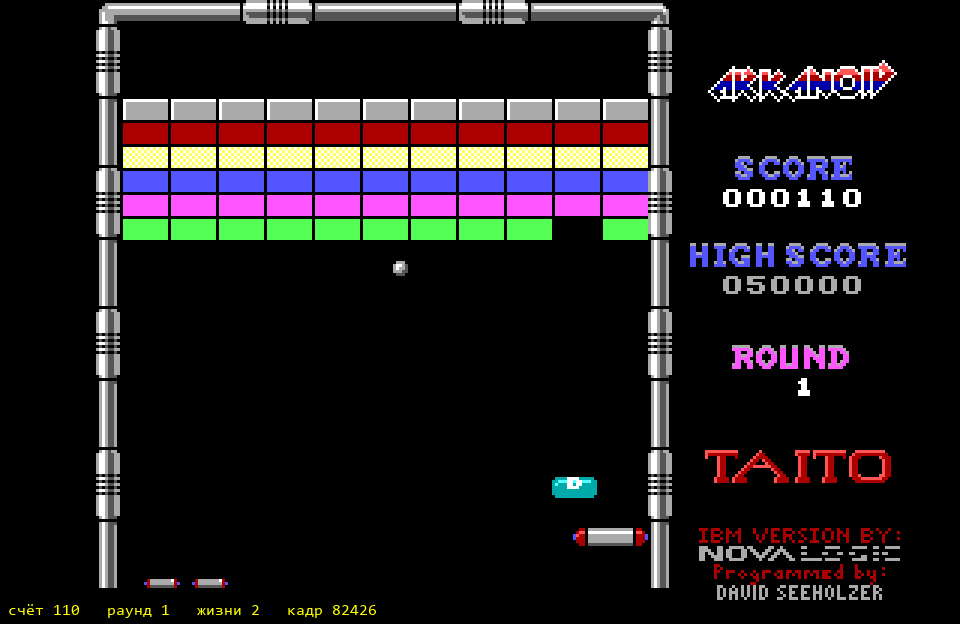
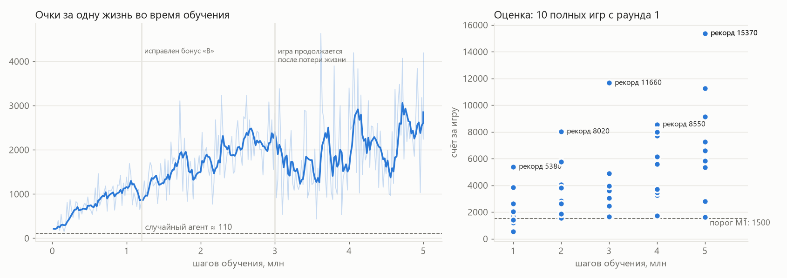
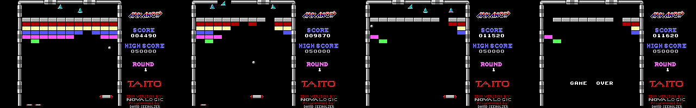
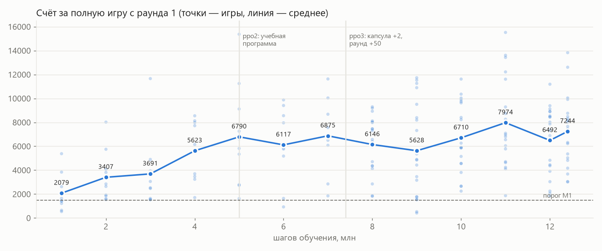

# Журнал обучения

## Скорость (2026-10-25)

Профилирование показало два узких места:

- **Опрос ввода.** DOSBox Pure опрашивал джойстики на 4 портах: 84 вызова Python за кадр.
  После отключения портов осталось 10 вызовов, и один эмулятор стал выдавать около 1950 кадров/с.
- **Обновление нейросети PPO на CPU.** Около 1,5 мс на образец (4 эпохи, NatureCNN, 93×96×4).
  Это потолок примерно в 600 шагов/с, как бы быстро ни работали среды. Intel Arc
  через torch недоступна: стоит сборка только для CPU.

| среды | потоки torch | только среды, шагов/с | PPO, шагов/с |
|---|---|---|---|
| 8 | 16 | 415 | 153 |
| 8 | 4 | 558 | 251 |
| 10 | 4 | 481 | 275 |
| 12 | 4 | 704 | 265 |
| 10 | 8 | 409 | 287 |

Выбрано 10 сред и 4 потока torch. Получается около 280–310 шагов/с, примерно 1 млн шагов в час.

## База: случайный агент (за одну жизнь, как в обучении)

60 эпизодов, `life_loss_terminal=True`: в среднем **104 очка** за жизнь (медиана 110, максимум 530),
эпизод около 35 шагов. Признак обучения — `neuronoid/points_mean` заметно выше 110.

## Прогон ppo1

`uv run python scripts/train.py --run ppo1 --steps 5000000 --envs 10` — PPO с RL Zoo-настройками,
обучение до первой потери жизни, награда только с экрана.

| время | шагов | points_mean | score_max | ep_len_mean | заметки |
|---|---|---|---|---|---|
| 13:38 | 598k | 677 (пик 934 на 478k) | 4060 (на 239k) | 76 | учится: очки за жизнь в 6–8 раз выше случайного агента (110) |
| 14:04 | 1143k | 1368 | 3930 | 98 | |

### Оценка на 1 млн шагов (10 полных игр с раунда 1, стохастическая политика, сид 1000)

Счёт по играм: 2620, 5380, 650, 1220*, 540, 1420, 1650, 3840, 1420, 2050. **М1 — 5 из 10** (нужно 7).

\* **Первый живой переход между раундами — и найденная ошибка награды.** В игре 4 агент поймал капсулу
«B» и ушёл в выход в правой стене. Игра перешла на раунд 2 с бонусом +6710 очков (1220 → 7930).
Защита от ложных скачков счёта (> 5000 за шаг) приняла бонус за ошибку чтения, известный счёт
застыл на 1220, и до конца игры агент не получал награды за очки. Исправлено: скачок, устойчивый
3 шага, становится новой базой (без выплаты, за раунд и так +10). После исправления повтор той же
игры даёт 8020 очков и раунд 2. Эпизод на переходе правильно не оборвался.

Прогон остановлен на 1,26 млн шагов и продолжен с `--resume` с чекпоинта 1,2 млн на исправленном коде.

| время | шагов | points_mean | score_max | ep_len_mean | заметки |
|---|---|---|---|---|---|
| 14:37 | 1676k | 1757 | 7050 | 137 | после исправления бонуса «B» |

### Оценка на 2 млн шагов — **М1 взята**

Счёт по играм: 4060, 2850, 1620, 8020 (раунд 2, выход «B»), 2640, 5750, 1930, 3810, 1540, 1850.
**М1: 10 из 10** игр не меньше 1500 очков (нужно 7). М2: 1 из 10.

| время | шагов | points_mean | score_max | ep_len_mean | заметки |
|---|---|---|---|---|---|
| 15:07 | 2282k | 1621 | 4780 | 157 | |
| 15:37 | 2924k | 2972 | 5620 | 184 | |

### Оценка на 3 млн шагов — и вторая найденная ошибка

Счёт по играм: 2530, 3620, 4900, 11660 (раунд 2), 2470, 3950, 1530, 1550, 3060, 1640. М1: 10 из 10, М2: 1 из 10.

**Агент хорошо играл только первую жизнь.** Очки по жизням в 6 играх: [330, 220, 90], [1530, 90, 110],
[2530, 110, 90], [2850, 3450, 90], [220, 180, 130], [8020, 0, 0]. Причина: при обучении по жизням
среда после каждой потери загружала свежий раунд 1, и агент никогда не видел вторую-третью жизнь
(полуразбитая стена, надпись «ROUND 1» поверх поля). Исправлено по образцу EpisodicLife из Atari:
потеря жизни — конец эпизода для обучения, но игра продолжается; с нуля — только после Game Over.
Прогон остановлен на 3,1 млн и продолжен с чекпоинта 3,0 млн на исправленной среде.

Важно для графиков: с этого места `points_mean` и `ep_len_mean` считаются по всем жизням, а не
только по первой (свежей). Возможен временный спад: вторая-третья жизнь для агента пока новая.

| время | шагов | points_mean | score_max | ep_len_mean | заметки |
|---|---|---|---|---|---|
| 16:13 | 3540k | 1906 | 12650 | 175 | по всем жизням; рекорд за жизнь 12650 |

### Оценка на 4 млн шагов — эффект исправления «игра продолжается после потери жизни»

Счёт по играм: 8550, 3240, 5580, 8130 (раунд 2), 7720, 6150, 3470, 7980, 1710, 3700. М1: 10 из 10, М2: 1 из 10.

| шагов | средний счёт за игру | медиана | игр ≥ 5000 |
|---|---|---|---|
| 1 млн | 2079 | 1650 | 1 |
| 2 млн | 3407 | 2850 | 2 |
| 3 млн | 3691 | 3060 | 1 |
| 4 млн | 5623 | 6150 | 6 |

Между 3 и 4 млн шагов средний счёт вырос в 1,5 раза: агент начал играть вторую и третью жизнь.
Рекорд в раунде 1 — 8550, это близко к полной очистке первого раунда.

| время | шагов | points_mean | score_max | ep_len_mean | заметки |
|---|---|---|---|---|---|
| 16:43 | 4213k | 2151 | 9640 | 210 | по всем жизням |
| 17:14 | 4903k | 1368 | 6990 | 220 | очки за жизнь ниже: в поздних жизнях меньше кирпичей осталось; длина жизни растёт |

### Итог прогона ppo1: 5 млн шагов, около 4,5 часов

Финальная оценка: 11250, 2730, 5820, 9120 (раунд 2), 5340, 6590, 2790, 7260, 1630, **15370**.
Средний счёт за игру — **6790** (на 1 млн шагов было 2079). М1: 10 из 10. М2: 1 из 10.

**Выводы:**
- Агент научился играть с нуля только по пикселям: средний счёт за игру вырос в 3,3 раза за 4 млн шагов,
  рекорд — 15 370 очков. Ступень М1 стабильна начиная с 2 млн шагов.
- Обе найденные ошибки (бонус «B» замораживал счёт; обучение только первой жизни) заметно мешали.
  После второго исправления средний счёт вырос в 1,5 раза за миллион шагов.
- Раунд 1 агент полностью не очищает даже при 15 370 очках. Вероятная причина — последние
  несколько кирпичей: в них трудно попасть, а потерянная жизнь стоит дорого. Раунд 2 агент видел
  только через капсулу «B». Для М2 нужны либо ещё шаги, либо учебная программа: старты с поздних
  стадий раунда 1 и с раунда 2 по savestate'ам, которые агент сам туда довёл (этап 5 спеки).
- Кривая ещё растёт: обучение не упёрлось в потолок.

## Прогон ppo2: учебная программа (этап 3)

`train.py --run ppo2 --init-from runs/ppo1/checkpoints/latest.zip --curriculum --steps 10000000 --envs 10`
— продолжение с весов ppo1. Половина новых игр начинается с позиций, до которых агент дошёл сам
(пул `runs/ppo2/starts`; позиция попадает в пул, только если после неё 60 шагов не было потери
жизни и Game Over). Перед стартом исправлено: клик в момент Game Over начинал новую игру
незаметно для среды. Перепроверка ppo1 на исправленной среде дала тот же результат (средний счёт 6790),
так что база для сравнения честная. Метрики `*_fresh` — только игры со свежего раунда 1, сравнимые с ppo1.

| время | шагов | points_mean_fresh | score_max_fresh | доля из пула | пул (раунд макс / позиций) | заметки |
|---|---|---|---|---|---|---|
| 20:41 | 5595k | 1400 | 2730 | 0.7 | 5 / 163 | пул быстро дошёл до раунда 5; свежие игры пока ниже ppo1 |
| 21:05 | 6022k | 2225 | 9590 | 0.3 | 6 / 207 | |

**Оценка на 6 млн:** 8560, 1640, 9880, 5860, 930, 5980, 5770, 7960, 5180, 9410 — средний **6117** (ppo1 на 5 млн: 6790),
медиана 5920, 8 игр ≥ 5000. М1 10 из 10, М2 0 из 10. Контрольная точка «учебная программа вредит»
(средний < 5000) не сработала, продолжаем. В пуле уже позиции до раунда 6.

| время | шагов | points_mean_fresh | score_max_fresh | доля из пула | пул (раунд макс / позиций) | заметки |
|---|---|---|---|---|---|---|
| 22:07 | 7340k | | | | 8 / 290 | |

**Оценка ppo2 на 7 млн:** 10040, 1850, 6760, 11630, 7560, 6800, 8680, 6080, 6500, 2850 — средний **6875**, М2 0 из 10.

**Почему раунд 1 не проходится — агент добывает капсулы.** В игре 4 (11 630 очков) 8 скачков по +1000
(пойманные капсулы) дали 8000 очков, кирпичи — около 3600; к концу игры полстены цела, особенно верхние
ряды. По награде это рационально: капсула +10, кирпич +0,5…1,2, прохождение раунда +10.
С согласия пользователя награда изменена: за очки — не больше 200 за шаг (капсула +2), за раунд **+50**.
ppo2 остановлен на 7,4 млн шагов.

## Прогон ppo3: новая награда

`train.py --run ppo3 --init-from runs/ppo2/checkpoints/latest.zip --curriculum --steps 12400000 --envs 10`.
Пул позиций взят из ppo2: 290 позиций, раунды 1–8.

| время | шагов | points_mean_fresh | score_max_fresh | доля из пула | пул (раунд макс / позиций) | заметки |
|---|---|---|---|---|---|---|
| 22:49 | 7920k | 2045 | 7850 (11370 на 7660k, раунд 2 в свежей игре) | 0.2 | 9 / 334 | |

**Оценка ppo3 на 8 млн (через 600 тыс. шагов после смены награды):** 7450, 7300, 8930 (раунд 2), 7460, 6570,
8040, 6140, 9190, 7980, 6390 — средний **7545**, худшая игра 6140 (раньше худшие были 1600–2900).
Игра стала заметно ровнее. М2: 1 из 10.

| время | шагов | points_mean_fresh | score_max_fresh | доля из пула | пул (раунд макс / позиций) | заметки |
|---|---|---|---|---|---|---|
| 23:48 | 9027k | 1185 | 4620 | | 9 / 356 | свежие игры проседают |

**Оценка ppo3 на 9 млн — резкая просадка:** 10900, 1530, 530, 4430, 8390, 420, 4850, 3160, 1780, 1550 —
средний **3754** (на 8 млн было 7545). Первая оценка ниже порога 5000; по плану стоп — после второй подряд.
Гипотеза: пул охватывает 9 раундов и выбирает раунд равновероятно, поэтому ~8/9 стартов из пула — раунды
2–9 (другие стены, враги), и агент «забывает» раунд 1. Кандидаты на исправление: откат к чекпоинту 8 млн;
выбор раунда ближе к фронту реальной игры; curriculum_prob 0.25.

**Перепроверка — просадки нет, это шум оценки.** Те же чекпоинты на другом наборе игр (сид 2000):
8 млн — средний 4748, 9 млн — 7502. Вместе (20 игр): 8 млн — 6147, 9 млн — 5628. Разброс между наборами
из 10 игр — около ±2500 очков, отдельные игры от 400 до 11 700. Вывод для методики: прогресс отслеживать
по 20 играм (сиды 1000 и 2000), зачёт ступеней — по-прежнему «≥ 7 из 10» на сиде 1000. Порог остановки
«средний < 5000 дважды подряд» применять к среднему по 20 играм.

| время | шагов | points_mean_fresh | score_max_fresh | доля из пула | пул (раунд макс / позиций) | заметки |
|---|---|---|---|---|---|---|
| 00:48 | 10035k | | | | | |

**Оценка ppo3 на 10 млн (20 игр):** сид 1000 — средний 6318, сид 2000 — 7101, вместе **6710**. М2 нет (0 и 1 из 10).
Игры стали долгими (до 1550 шагов), но раунд 1 не очищается. Что остаётся на поле
(кадры на 400, 800, 1200 шагах и последний перед Game Over):

Остаются верхний ряд серых кирпичей у потолка (их нужно бить дважды) и одиночные кирпичи по углам.
С 800-го по 1200-й шаг агент набрал всего 1650 очков. Это проблема «последних кирпичей»: попасть трудно,
а награда редкая (первый удар по серому кирпичу очков не даёт).

| время | шагов | points_mean_fresh | score_max_fresh | доля из пула | пул (раунд макс / позиций) | заметки |
|---|---|---|---|---|---|---|

**Оценка ppo3 на 11 млн (20 игр):** сид 1000 — 8124, сид 2000 — 7823, вместе **7974** — лучший результат проекта
(ppo1 на 5 млн: 6790; ppo3 на 10 млн: 6710). Рекорд 15 520, игры до 1929 шагов. М2: 0 и 1 из 10.

**Оценка ppo3 на 12 млн (20 игр):** сид 1000 — 7217, сид 2000 — 5766, вместе **6492**. М2: 2 и 1 из 10 —
все три выхода в раунд 2 за 320–350 шагов, то есть через капсулу «B», а не очисткой стены.

## Итог этапа 3 (ppo2 + ppo3, 5 → 12,4 млн шагов)

Финальная оценка ppo3 на 12,4 млн (20 игр): сид 1000 — 7522, сид 2000 — 6967, вместе **7244**. М1 — да, М2 — нет
(1 из 20, через «B»).

**Выводы:**
- **Плато.** После 5 млн шагов средний счёт за игру держится около 6500–8000 (лучший — 7974 на 11 млн).
  Учебная программа и новая награда сделали игру ровнее (меньше провальных игр), но М2 не дали.
- **Раунд 1 не очищается ни разу** за все прогоны: остаются верхний ряд серых кирпичей у потолка и одиночные
  кирпичи в углах. Раунд 2 агент видит только через капсулу «B».
- **Найдено и исправлено по ходу:** незаметная новая игра после клика на Game Over; пул из уже проигранных
  позиций; «фарм» капсул (капсула стоила как раунд); шум оценки по 10 играм (теперь 20).
- **Пул дошёл до раунда 9** (позиции, до которых агент добрался сам, в основном через выходы «B»).

**Кандидаты для следующего шага (не сделано):**
1. Награда за каждое попадание по кирпичу, видимое в пикселях поля (в том числе первый удар по серому),
   а не только за разрушение — плотный сигнал именно там, где агент застревает.
2. Учебная программа, нацеленная на фронт: чаще стартовать с поздних позиций раунда 1 (сейчас ~5% игр),
   а не равномерно по 9 раундам.
3. Больше шагов и/или ускорение обновления сети (графический чип MacBook M4).

## Прогон ppo4: награда за кирпичи и учебная программа на конец раунда (этап 4)

Что нового: считыватель кирпичей по пикселям поля (сетка 16×8, 11 столбцов); награда +0.5 за кирпич и ещё
+2 за кирпич, когда их осталось не больше 10; половина стартов из пула — раунд 1, позиции ранжируются по
числу оставшихся кирпичей, не больше 5 позиций с одинаковым числом. Удар по серому кирпичу на экране
увидеть не удалось, отдельной награды за него нет. Золотые (неразрушимые) кирпичи считаются кирпичами —
для раундов 3, 6, 8 это значит, что «последние 10» там не наступают; для раунда 1 неважно.

**База ppo3 (20 игр): кирпичей осталось в конце игры** — 46 49 56 30 12 41 46 14 47 34 / 24 53 17 35 45 65 40 56 27 50:
минимум 12, медиана около 42 (65 — игра, ушедшая через «B» в раунд 2).

`train.py --run ppo4 --init-from runs/ppo3/checkpoints/latest.zip --curriculum --steps 17400000 --envs 10`;
пул из ppo3 с досчитанным числом кирпичей и прореженный: 88 позиций, раунды 1–9.

| время | шагов | points_mean_fresh | bricks_left_min_fresh | доля из пула | пул (раунд макс / позиций) | заметки |
|---|---|---|---|---|---|---|
| 07:34 | 12958k | 2893 | 35 (14 на 12679k) | 0.1 | 9 / 253 | очки за жизнь в свежих играх ~3000 (ppo3 ~2000) |

**Оценка ppo4 на 13 млн (20 игр):** сид 1000 — 7452, сид 2000 — 8620, вместе **8036** (лучший результат проекта).
До раунда 2 — **5 из 20** (М2 на сиде 1000: 3 из 10). Кирпичей осталось в конце, лучшая игра — **5** (ppo3: 12).
Повтор пяти игр с раундом 2: все выходы — **через капсулу «B»** (в раунде 1 оставалось 55–64 кирпича).
Агент научился чаще ловить «B» и уходить в выход (5 из 20 против 1 у ppo3) — видимо, из-за бонуса +50 за раунд.
Это законный ход по правилам игры и засчитывается в М2, но стену раунда 1 агент по-прежнему не очищает.

| время | шагов | points_mean_fresh | bricks_left_min_fresh | доля из пула | пул (раунд макс / позиций) | заметки |
|---|---|---|---|---|---|---|
| 08:32 | 14000k | | | | | |

**Оценка ppo4 на 14 млн (20 игр):** 6676 / 7429, вместе **7053**. До раунда 2 — 1 из 20. Лучший результат по
кирпичам — 21. Хуже, чем на 13 млн, но в пределах шума оценки (±2500 по среднему, выходы «B» случайны).

**Оценка ppo4 на 15 млн (20 игр):** 8288 / 6651, вместе **7470**. До раунда 2 — 3 из 20 (через «B»).
Лучший результат по кирпичам — 5.

**Оценка ppo4 на 16 млн (20 игр):** 7520 / 9082, вместе **8301** — лучший результат проекта. Рекорд 16 140.
До раунда 2 — 3 из 20 (через «B»). Лучший результат по кирпичам — 10.
